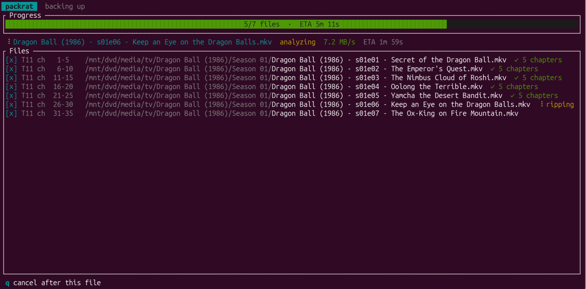

# packrat

A free and open source physical media backup utility.



New here? [Installation](installation.md) covers every platform, and explains
how to enable CSS decryption for encrypted discs. Encrypted Blu-rays need a
user-supplied `KEYDB.cfg`; [Blu-ray and AACS keys](blu-ray.md) explains why and
how to import it.

## Quick start

```sh
packrat
```

packrat opens a desktop window. It detects the disc, shows what it thinks it is,
and asks before writing anything. From there you can:

- set the **TV directory** and **movie directory** to the folders that already
  hold your show and movie folders, such as an existing Plex library
  (`/mnt/media/tv`, `/mnt/media/movies`). On the first run packrat opens the
  settings screen for this. They are remembered between runs.
- add an optional **TMDb API key** on the settings screen (or set
  `TMDB_API_KEY`) so movies are named from TMDb. Without a key, movies are named
  from the disc label, so the whole pipeline still works offline.
- pick which drive to read from the dropdown when more than one is attached. The
  window shows what it found — the drive, and the disc in it — before you commit
  to anything, and you can browse to a mounted folder instead of using a drive
- correct the **show**, **season** and **first episode** if TVmaze guessed
  wrong (packrat searches TVmaze for the name). Later discs of a season are
  numbered after the episodes already in your library, so a final disc holding
  fewer episodes than the earlier ones still lands on the right numbers; the
  **first episode** box overrides that when the label is wrong
- correct the **movie title and year** if TMDb guessed wrong; when several
  releases match, the arrow buttons step through the candidates
- tick or untick individual files, and add **extras** (trailers/featurettes).
  A movie disc lists every bonus title next to the feature, so you pick what to
  back up in the one list
- press **Eject** when you are done, or enable **Eject when done** in settings
  to open the tray automatically after a clean run

The settings screen carries a summary of your collection: how many shows,
seasons, episodes and movies are on disk, the storage used and free, and the
all-time discs and bytes packrat has written. It stays out of the way until you
open it.

Files are written straight into the configured directory with Plex's naming:

```text
<tv directory>/<Show (Year)>/Season 01/<Show (Year>) - s01e01 - <Episode>.mkv
<movie directory>/<Title (Year)>/<Title (Year)>.mkv
<movie directory>/<Title (Year)>/Other/<Extra>.mkv
```

Leave a directory empty to write plain MKVs into the current directory instead.

A typical session:

1. Start `packrat` with a disc inserted. On the first run, set your TV and movie
   directories and press **Save**.
2. Check the disc packrat found and correct the show, season or first episode if
   it guessed wrong, then press **Look up metadata**.
3. Check the proposed files, unticking anything you do not want.
4. Press **Back up**. Progress is shown per file, and a run can be stopped after
   the current file or immediately. With **Eject when done** enabled the tray
   opens once it finishes cleanly; otherwise press **Eject** on the result
   screen.
